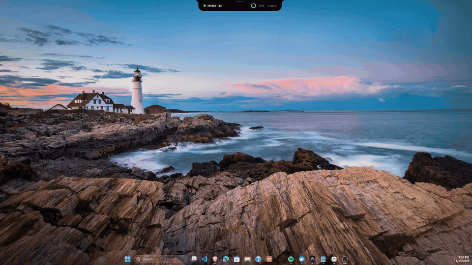

# Notchi

**A hardware-grade macOS-style top-bezel Jira Notch utility for Windows 10 & 11.**

---

## Video Demo

---

## Features

- **Tactile Top-Bezel Hardware Notch** — Sits flush at the top-center of your display with authentic outward concave notch ears and 2× Lanczos supersampled anti-aliasing (zero wallpaper bleed-through).
- **120Hz Hover Expand & Collapse** — Rests as a slim pill showing your active project total, completion percentage, and mini activity ring, and smoothly expands into the full **Nook** view when you move your cursor to the top bezel.
- **Live Multi-Space Jira Kanban Sync** — Automatically discovers all Jira Spaces you work in (`SM360`, `AAIRI`, `HRIS`, `Inventory and Procurement`, `LIMS`, `LMS`, `CUSP`, `AMS`, etc.) and adapts the 3×3 Kanban status grid to each space's workflow. Click the **`Board ▾`** switcher pill inside the Notch to jump between spaces or view **`All My Spaces`**.
- **Automatic Dev & IQA Role Detection** — Automatically detects whether you are a **Developer** (`Assignee`) or an **IQA Officer** (`IQA Officer` / active `Watcher`), with a 1-click **`Role: DEV / IQA / ALL`** toggle pill right inside the Notch.
- **Bubble-Animated Floating Task List** — Click any status tile inside the Notch to bloom open a hardware-rounded Windows 11 floating panel listing every ticket in that column with its Issue Key, FRD Document ID, attachment count, and summary.
- **Full Ticket & Attachment Inspector** — Click any task row to bloom open the companion **Task Inspector** widget displaying custom fields (`Document ID`, `Team`, `Consult To`, `Environment`), full parsed Atlassian Document Format (`ADF`) descriptions, and 1-click attachment viewing.
- **End-to-End Multi-Monitor Dragging** — Click and drag the Notch seamlessly across dual or triple monitors, or double-click the top grip to snap directly to the center of your current display.
- **Permanent Local Account Cache** — Caches your Atlassian session locally in `%LOCALAPPDATA%\Notchi\` so you never have to log in again, automatically prompting you only when your Jira API token expires.
- **Standalone Windows Executable (`Notchi.exe`)** — Runs out of the box on Windows 10/11 (x64) with zero Python runtime or external dependencies required.
